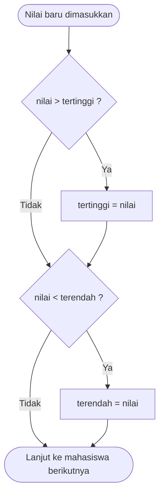
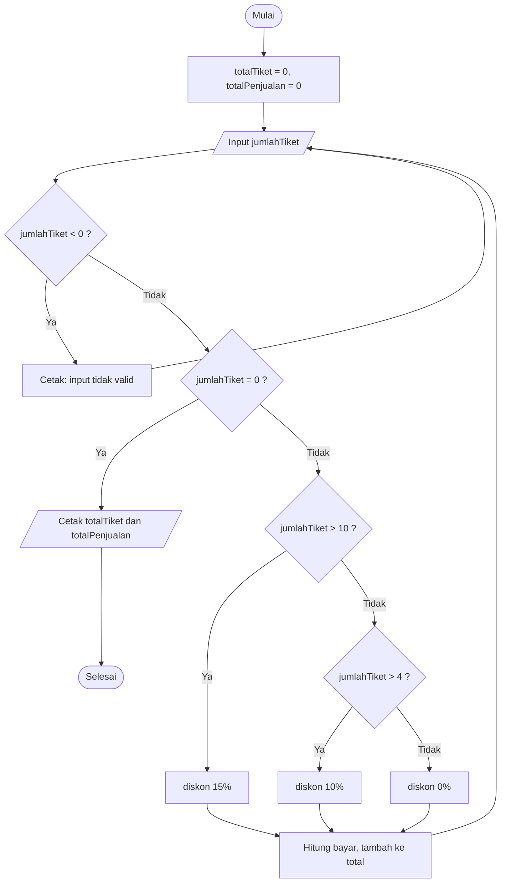

<div align="center">

# 📘 JOBSHEET 7 — PERULANGAN 1 📘

**Praktikum Dasar Pemrograman 2026 · Politeknik Negeri Malang**

</div>

| | |
|---|---|
| 👤 **Nama** | [Elia Beril](https://www.instagram.com/ellxzrst.22/) |
| 🆔 **NIM** | 264107020027 |
| 🔢 **No. Presensi** | 13 |
| 📚 **Mata Kuliah** | Praktikum Dasar Pemrograman |
| 📝 **Materi** | Perulangan 1 (`for`, `while`, `do-while`) |
| ☕ **Bahasa** | Java |

> 📝 Dokumen ini memuat **Pertanyaan** (Percobaan 1–3) dan **Tugas**. Langkah-langkah praktikum tidak diulang. Semua hasil *run* berasal dari program yang benar-benar dijalankan.

---

## 🗂️ Struktur Repositori

```text
daspro-jobsheet7
├── experiment/                       → 5 file Percobaan
│   ├── SiakadFor13exp.java
│   ├── SiakadForLulus13exp.java
│   ├── SiakadWhile13exp.java
│   ├── SiakadWhileBagus13exp.java
│   └── KafeDoWhile13exp.java
├── assignment/                       → 2 file Tugas
│   ├── Tugas1Bioskop13assign.java
│   └── Tugas2Parkir13assign.java
└── EliaBeril_Jobsheet_7_Perulangan_1.md (dokumen ini)
```

Klik nama file untuk membuka **kode asli** di repositori

| No | Folder | File (klik untuk lihat kode asli) |
|:-:|---|---|
| 1 | `experiment/` | [`SiakadFor13exp.java`](experiment/SiakadFor13exp.java) |
| 2 | `experiment/` | [`SiakadForLulus13exp.java`](experiment/SiakadForLulus13exp.java) |
| 3 | `experiment/` | [`SiakadWhile13exp.java`](experiment/SiakadWhile13exp.java) |
| 4 | `experiment/` | [`SiakadWhileBagus13exp.java`](experiment/SiakadWhileBagus13exp.java) |
| 5 | `experiment/` | [`KafeDoWhile13exp.java`](experiment/KafeDoWhile13exp.java) |
| 6 | `assignment/` | [`Tugas1Bioskop13assign.java`](assignment/Tugas1Bioskop13assign.java) |
| 7 | `assignment/` | [`Tugas2Parkir13assign.java`](assignment/Tugas2Parkir13assign.java) |

---

## 📑 Daftar Isi

1. [Percobaan 1 — Perulangan FOR (Nilai SIAKAD)](#1-percobaan-1--perulangan-for-nilai-siakad)
2. [Percobaan 2 — Perulangan WHILE (Kategori Nilai)](#2-percobaan-2--perulangan-while-kategori-nilai)
3. [Percobaan 3 — Perulangan DO-WHILE (Transaksi Kafe)](#3-percobaan-3--perulangan-do-while-transaksi-kafe)
4. [Tugas](#4-tugas)
5. [Lampiran — Kode Lengkap](#5-lampiran--kode-lengkap-semua-file)
6. [Catatan Asumsi](#6-catatan-asumsi)

---

# 1. Percobaan 1 — Perulangan FOR (Nilai SIAKAD)

📄 File: [`SiakadFor13exp.java`](experiment/SiakadFor13exp.java) · Modifikasi Pertanyaan 4: [`SiakadForLulus13exp.java`](experiment/SiakadForLulus13exp.java)

**Hasil run sesuai contoh jobsheet** (10 nilai kuis):
```text
Masukkan nilai mahasiswa ke-1: 76.5
Masukkan nilai mahasiswa ke-2: 82.3
Masukkan nilai mahasiswa ke-3: 62.1
Masukkan nilai mahasiswa ke-4: 88.4
Masukkan nilai mahasiswa ke-5: 65.9
Masukkan nilai mahasiswa ke-6: 67.9
Masukkan nilai mahasiswa ke-7: 90.1
Masukkan nilai mahasiswa ke-8: 55.3
Masukkan nilai mahasiswa ke-9: 73.7
Masukkan nilai mahasiswa ke-10: 78.6
Nilai tertinggi: 90.1
Nilai terendah: 55.3
```

### ❓ Pertanyaan 1
**Sebutkan dan tunjukkan masing-masing komponen perulangan FOR pada kode program Percobaan 1!**

```java
for (int i = 1; i <= 10; i++) {
    // badan perulangan
}
```

| Komponen | Pada kode | Fungsi |
|---|---|---|
| **Inisialisasi** | `int i = 1` | membuat variabel pencacah `i` dan memberi nilai awal 1. Hanya dijalankan **sekali** di awal |
| **Kondisi** | `i <= 10` | diperiksa **sebelum** setiap putaran. Selama `true`, badan perulangan dijalankan |
| **Update** | `i++` | menaikkan `i` sebesar 1 **setelah** badan perulangan selesai, lalu kembali ke pemeriksaan kondisi |
| **Badan (body)** | kode di dalam `{ }` | input nilai, lalu dua `if` pembanding nilai tertinggi dan terendah |

Perulangan berjalan untuk `i` = 1, 2, ..., 10, jadi tepat **10 kali** (sesuai jumlah mahasiswa). Saat `i` menjadi 11, kondisi `false` dan program keluar dari perulangan.

### ❓ Pertanyaan 2
**Mengapa `tertinggi` diinisialisasi 0 dan `terendah` diinisialisasi 100? Apa yang terjadi jika dibalik?**

Nilai kuis berada pada rentang **0 sampai 100**. Nilai awal dipilih supaya **nilai pertama** yang masuk langsung menggantikannya:

- `tertinggi = 0` adalah nilai paling kecil yang mungkin, jadi nilai berapa pun yang lebih besar dari 0 akan menggantikannya, lalu terus naik sampai menemukan yang terbesar.
- `terendah = 100` adalah nilai paling besar yang mungkin, jadi nilai berapa pun yang lebih kecil dari 100 akan menggantikannya, lalu terus turun sampai menemukan yang terkecil.

**Jika dibalik** (`tertinggi = 100`, `terendah = 0`), kondisi `nilai > tertinggi` (lebih dari 100) dan `nilai < terendah` (kurang dari 0) **tidak pernah terpenuhi** untuk nilai yang valid. Nilai awal tidak pernah diganti sehingga hasilnya selalu salah. Hasil run dengan 10 nilai yang sama seperti di atas:

```text
Nilai tertinggi: 100.0
Nilai terendah: 0.0
```

> 💡 Cara lain yang tidak bergantung pada rentang nilai: isi `tertinggi` dan `terendah` dengan **nilai mahasiswa pertama**, lalu bandingkan mulai dari mahasiswa kedua.

### ❓ Pertanyaan 3
**Jelaskan fungsi dan alur kerja dari potongan kode berikut!**

```java
if (nilai > tertinggi) {
    tertinggi = nilai;
}
if (nilai < terendah) {
    terendah = nilai;
}
```

Potongan ini **memperbarui rekor** nilai tertinggi dan terendah setiap kali satu nilai dimasukkan. Kedua `if` ditulis **terpisah** (bukan `else if`) karena keduanya perlu dicek untuk setiap nilai. Misalnya mahasiswa pertama bisa sekaligus menjadi tertinggi dan terendah.



**Penelusuran dengan input 76.5 → 82.3 → 62.1:**

| Mahasiswa | nilai | `nilai > tertinggi` | tertinggi | `nilai < terendah` | terendah |
|:-:|:-:|:-:|:-:|:-:|:-:|
| awal | | | 0 | | 100 |
| 1 | 76.5 | 76.5 > 0 ✅ | 76.5 | 76.5 < 100 ✅ | 76.5 |
| 2 | 82.3 | 82.3 > 76.5 ✅ | 82.3 | 82.3 < 76.5 ❌ | 76.5 |
| 3 | 62.1 | 62.1 > 82.3 ❌ | 82.3 | 62.1 < 76.5 ✅ | 62.1 |

### ❓ Pertanyaan 4
**Modifikasi kode agar menghitung mahasiswa yang lulus dan tidak lulus (batas lulus nilai minimal 60).**

Ditambahkan dua penghitung `lulus` dan `tidakLulus` (bertipe `int`, awal 0). Di dalam perulangan, setiap nilai diperiksa: bila `nilai >= 60` maka `lulus++`, selain itu `tidakLulus++`. Hasilnya ditampilkan **setelah** nilai tertinggi dan terendah.

📄 File: [`SiakadForLulus13exp.java`](experiment/SiakadForLulus13exp.java)

```java
if (nilai >= 60) {
    lulus++;
} else {
    tidakLulus++;
}
```

**Hasil run** (nilai ke-10 diganti 59.9 agar ada yang tidak lulus):
```text
Masukkan nilai mahasiswa ke-1: 76.5
Masukkan nilai mahasiswa ke-2: 82.3
Masukkan nilai mahasiswa ke-3: 62.1
Masukkan nilai mahasiswa ke-4: 88.4
Masukkan nilai mahasiswa ke-5: 65.9
Masukkan nilai mahasiswa ke-6: 67.9
Masukkan nilai mahasiswa ke-7: 90.1
Masukkan nilai mahasiswa ke-8: 55.3
Masukkan nilai mahasiswa ke-9: 73.7
Masukkan nilai mahasiswa ke-10: 59.9
Nilai tertinggi: 90.1
Nilai terendah: 55.3
Jumlah mahasiswa lulus: 8
Jumlah mahasiswa tidak lulus: 2
```

Nilai yang tidak lulus adalah 55.3 dan 59.9, sisanya 8 mahasiswa lulus. Nilai **tepat 60** dihitung lulus karena memakai `>=`.

---

# 2. Percobaan 2 — Perulangan WHILE (Kategori Nilai)

📄 File: [`SiakadWhile13exp.java`](experiment/SiakadWhile13exp.java) · Modifikasi Pertanyaan 4: [`SiakadWhileBagus13exp.java`](experiment/SiakadWhileBagus13exp.java)

**Hasil run sesuai contoh jobsheet** (jumlah mahasiswa 5, ada dua input tidak valid):
```text
Masukkan jumlah mahasiswa: 5
Masukkan nilai mahasiswa ke-1: 85
Nilai mahasiswa ke-1 adalah A
Masukkan nilai mahasiswa ke-2: 63
Nilai mahasiswa ke-2 adalah C+
Masukkan nilai mahasiswa ke-3: 101
Nilai tidak valid. Masukkan lagi nilai yang valid!
Masukkan nilai mahasiswa ke-3: 23
Nilai mahasiswa ke-3 adalah E
Masukkan nilai mahasiswa ke-4: -15
Nilai tidak valid. Masukkan lagi nilai yang valid!
Masukkan nilai mahasiswa ke-4: 70
Nilai mahasiswa ke-4 adalah B
Masukkan nilai mahasiswa ke-5: 55
Nilai mahasiswa ke-5 adalah C
```

**Uji batas kategori** (semua sesuai ketentuan soal):

| Nilai | 100 | 81 | 80 | 74 | 73 | 66 | 65 | 61 | 60 | 51 | 50 | 40 | 39 | 0 |
|:-:|:-:|:-:|:-:|:-:|:-:|:-:|:-:|:-:|:-:|:-:|:-:|:-:|:-:|:-:|
| Huruf | A | A | B+ | B+ | B | B | C+ | C+ | C | C | D | D | E | E |

### ❓ Pertanyaan 1
**Tentukan maksud dan kegunaan sintaks berikut:**

```java
if (nilai < 0 || nilai > 100) {
    System.out.println("Nilai tidak valid. Masukkan lagi nilai yang valid!");
    continue;
}
```

**a. `nilai < 0 || nilai > 100`**

Kondisi **validasi input**. Operator **OR (`||`)** bernilai `true` bila **salah satu** sisi `true`:

| Bagian | Arti |
|---|---|
| `nilai < 0` | nilai negatif (di bawah rentang) |
| `nilai > 100` | nilai melebihi 100 (di atas rentang) |
| `\|\|` | cukup salah satu terpenuhi, nilai sudah dianggap **tidak valid** |

Nilai valid adalah **0 sampai 100**. Dua sisi tidak mungkin `true` bersamaan, sehingga `||` adalah operator yang tepat. Bila memakai `&&`, kondisi tidak akan pernah `true`.

**b. `continue`**

`continue` **melewati sisa badan perulangan** pada putaran itu dan langsung kembali ke pemeriksaan kondisi `while (i < jml)`. Pada program ini, ketika nilai tidak valid:

1. Pesan kesalahan ditampilkan.
2. `continue` membuat program **tidak** menjalankan blok kategori huruf dan `i++`.
3. Karena `i` tidak bertambah, putaran berikutnya meminta input untuk **mahasiswa yang sama** (lihat "ke-3" dan "ke-4" muncul dua kali pada hasil run).

### ❓ Pertanyaan 2
**Mengapa `i++` ditulis di akhir perulangan WHILE? Apa yang terjadi jika di awal?**

`i++` di akhir berarti `i` hanya bertambah **setelah** nilai valid selesai diproses. Karena itu:

- nomor mahasiswa yang tampil (`i + 1`) sudah benar, dimulai dari **ke-1**;
- input tidak valid (yang melewati `i++` lewat `continue`) **tidak dihitung** sebagai mahasiswa, jadi diminta ulang untuk mahasiswa yang sama.

**Jika `i++` dipindah ke awal perulangan**, hasil run dengan input `5`, lalu `85`, `101`, `63`, `23`, `70`:

```text
Masukkan jumlah mahasiswa: 5
Masukkan nilai mahasiswa ke-2: 85
Nilai mahasiswa ke-2 diterima: 85
Masukkan nilai mahasiswa ke-3: 101
Nilai tidak valid. Masukkan lagi nilai yang valid!
Masukkan nilai mahasiswa ke-4: 63
Nilai mahasiswa ke-4 diterima: 63
Masukkan nilai mahasiswa ke-5: 23
Nilai mahasiswa ke-5 diterima: 23
Masukkan nilai mahasiswa ke-6: 70
Nilai mahasiswa ke-6 diterima: 70
```

Dua akibatnya:

1. **Penomoran bergeser**: mahasiswa pertama tampil sebagai "ke-2" (dan terakhir "ke-6" padahal jumlahnya 5).
2. **Input tidak valid ikut menghabiskan jatah putaran**: `101` sudah menaikkan `i`, sehingga tidak diulang untuk mahasiswa yang sama. Dari 5 putaran hanya **4 nilai valid** yang terproses.

### ❓ Pertanyaan 3
**Jika jumlah mahasiswa yang dimasukkan 19, berapa kali perulangan WHILE berjalan?**

`i` mulai dari 0 dan perulangan berjalan selama `i < 19`, yaitu untuk `i` = 0, 1, ..., 18. Jadi **19 kali** bila semua nilai yang dimasukkan **valid**. Hasil run dengan 19 nilai valid menampilkan tepat 19 kali baris "Masukkan nilai mahasiswa ke-...".

> 💡 Setiap **input tidak valid** menambah **satu putaran ekstra** (karena `continue` tidak menaikkan `i`). Jadi jumlah putaran sebenarnya = 19 + banyaknya input tidak valid.

### ❓ Pertanyaan 4
**Modifikasi agar nilai A menampilkan pesan tambahan "Bagus, pertahankan nilainya"!**

Satu baris `System.out.println` ditambahkan di dalam blok `if` untuk kategori A.

📄 File: [`SiakadWhileBagus13exp.java`](experiment/SiakadWhileBagus13exp.java)

```java
if (nilai > 80 && nilai <= 100) {
    System.out.println("Nilai mahasiswa ke-" + (i + 1) + " adalah A");
    System.out.println("Bagus, pertahankan nilainya");
} else if (nilai > 73 && nilai <= 80) {
    ...
```

**Hasil run** (jumlah mahasiswa 2):
```text
Masukkan jumlah mahasiswa: 2
Masukkan nilai mahasiswa ke-1: 85
Nilai mahasiswa ke-1 adalah A
Bagus, pertahankan nilainya
Masukkan nilai mahasiswa ke-2: 70
Nilai mahasiswa ke-2 adalah B
```

Pesan hanya muncul untuk nilai A. Mahasiswa dengan nilai B tidak mendapat pesan tambahan.

---

# 3. Percobaan 3 — Perulangan DO-WHILE (Transaksi Kafe)

📄 File: [`KafeDoWhile13exp.java`](experiment/KafeDoWhile13exp.java)

**Hasil run sesuai contoh jobsheet** (nama `BATAL` huruf besar tetap dikenali karena `equalsIgnoreCase`):
```text
Masukkan nama pelanggan (ketik 'batal' untuk keluar): Rena
Jumlah kopi: 3
Jumlah teh: 0
Jumlah roti: 1
Total yang harus dibayar: Rp 56000
Masukkan nama pelanggan (ketik 'batal' untuk keluar): Yuni
Jumlah kopi: 1
Jumlah teh: 4
Jumlah roti: 2
Total yang harus dibayar: Rp 80000
Masukkan nama pelanggan (ketik 'batal' untuk keluar): BATAL
Transaksi dibatalkan.
Semua transaksi selesai.
```

**Cek perhitungan:**

| Pelanggan | Kopi (12.000) | Teh (7.000) | Roti (20.000) | Total |
|---|--:|--:|--:|--:|
| Rena | 3 × 12.000 = 36.000 | 0 | 1 × 20.000 = 20.000 | **56.000** |
| Yuni | 1 × 12.000 = 12.000 | 4 × 7.000 = 28.000 | 2 × 20.000 = 40.000 | **80.000** |

### ❓ Pertanyaan 1
**Bila nama pelanggan pertama kali adalah "batal", berapa kali perulangan dilakukan?**

**1 kali.** DO-WHILE mengeksekusi badan perulangan **dulu**, baru memeriksa kondisi. Jadi badan selalu berjalan minimal sekali. Pada putaran pertama itu nama "batal" terbaca, `if` bernilai `true`, lalu `break` menghentikan perulangan. Pesan yang muncul hanya:

```text
Masukkan nama pelanggan (ketik 'batal' untuk keluar): batal
Transaksi dibatalkan.
Semua transaksi selesai.
```

Pada WHILE atau FOR, badan bisa berjalan **0 kali** bila kondisi awal sudah `false`. Pada DO-WHILE hal itu tidak mungkin terjadi.

### ❓ Pertanyaan 2
**Sebutkan kondisi berhenti yang digunakan pada perulangan DO-WHILE tersebut!**

Perulangan berhenti ketika **nama pelanggan yang dimasukkan adalah "batal"**, tanpa memperhatikan huruf besar/kecil:

```java
if (namaPelanggan.equalsIgnoreCase("batal")) {
    System.out.println("Transaksi dibatalkan.");
    break;
}
```

Jadi kondisi berhentinya ada **di dalam badan perulangan** (lewat `break`), bukan pada `while (...)`.

### ❓ Pertanyaan 3
**Apa fungsi penggunaan nilai `true` pada kondisi DO-WHILE?**

`while (true)` membuat kondisi **selalu benar** sehingga perulangan menjadi **tak hingga** (*infinite loop*) dan tidak pernah berhenti sendiri. Dengan begitu kasir bisa memproses **pelanggan sebanyak apa pun**, karena jumlah pelanggan tidak diketahui di awal. Satu-satunya jalan keluar adalah `break` ketika nama "batal" dimasukkan.

### ❓ Pertanyaan 4
**Mengapa perulangan DO-WHILE tetap berjalan meskipun tidak ada komponen inisialisasi dan update?**

Karena inisialisasi dan update hanyalah bagian dari **pola perulangan berbasis pencacah** seperti FOR. DO-WHILE tidak membutuhkannya. Ia hanya memerlukan **kondisi**, dan di sini kondisinya konstan `true`. Perulangan **tidak memakai pencacah** (jumlah pelanggan tidak ditentukan), sehingga tidak ada variabel yang perlu diinisialisasi atau di-*update*. Yang mengendalikan kapan berhenti adalah **masukan pengguna** ("batal") dan `break`.

> 💡 Perhatikan juga `sc.nextLine();` di akhir badan. Setelah `sc.nextInt()`, tombol Enter masih tertinggal di *buffer*. Tanpa `nextLine()` pembersih, pada putaran berikutnya `nextLine()` pembaca nama langsung menerima baris kosong, sehingga nama pelanggan terlewat.

---

# 4. Tugas

### 📌 Tugas 1 — Penjualan Tiket Bioskop

📄 File: [`Tugas1Bioskop13assign.java`](assignment/Tugas1Bioskop13assign.java)

Harga tiket **Rp50.000**. Program meminta jumlah tiket tiap pelanggan, menghitung total bayar setelah diskon, lalu menampilkan **total tiket terjual** dan **total penjualan** satu hari.

> ⚠️ Soal tidak menyebut cara mengakhiri input, jadi saya **asumsikan** memasukkan `0` berarti penjualan hari itu selesai.

**Aturan diskon:**

| Jumlah tiket | Diskon |
|:-:|:-:|
| 1 – 4 | 0% |
| 5 – 10 (lebih dari 4) | 10% |
| lebih dari 10 | 15% |
| negatif | tidak valid, input diulang |
| 0 | selesai |

Diskon 15% menggantikan diskon 10% (tidak ditumpuk), karena pembelian lebih dari 10 tiket juga lebih dari 4 tiket.



**Hasil run** (3, 5, 10, 11 tiket, lalu input `-2` yang tidak valid, 2 tiket, dan `0` untuk selesai):
```text
=== Penjualan Tiket Bioskop ===
Jumlah tiket yang dibeli pelanggan (0 untuk selesai): 3
Diskon: 0% | Total bayar: Rp150000
Jumlah tiket yang dibeli pelanggan (0 untuk selesai): 5
Diskon: 10% | Total bayar: Rp225000
Jumlah tiket yang dibeli pelanggan (0 untuk selesai): 10
Diskon: 10% | Total bayar: Rp450000
Jumlah tiket yang dibeli pelanggan (0 untuk selesai): 11
Diskon: 15% | Total bayar: Rp467500
Jumlah tiket yang dibeli pelanggan (0 untuk selesai): -2
Input tidak valid. Masukkan lagi jumlah tiket!
Jumlah tiket yang dibeli pelanggan (0 untuk selesai): 2
Diskon: 0% | Total bayar: Rp100000
Jumlah tiket yang dibeli pelanggan (0 untuk selesai): 0
Total tiket terjual : 31
Total penjualan     : Rp1392500
```

**Cek manual:**

| Tiket | Perhitungan | Total bayar |
|:-:|---|--:|
| 3 | 3 × 50.000 | 150.000 |
| 5 | 5 × 50.000 × 90% | 225.000 |
| 10 | 10 × 50.000 × 90% (batas, belum "lebih dari 10") | 450.000 |
| 11 | 11 × 50.000 × 85% | 467.500 |
| 2 | 2 × 50.000 | 100.000 |
| **Jumlah** | 31 tiket | **1.392.500** |

Input `-2` diabaikan dengan `continue`, jadi tidak ikut dihitung.

---

### 📌 Tugas 2 — Tempat Parkir (Implementasi Flowchart)

📄 File: [`Tugas2Parkir13assign.java`](assignment/Tugas2Parkir13assign.java)

Program mengimplementasikan flowchart pada soal. Tarif: **mobil Rp3.000/jam**, **motor Rp2.000/jam**. Input jenis kendaraan: `1` mobil, `2` motor, `0` keluar. Perulangan memakai **DO-WHILE** karena flowchart memeriksa kondisi `while (jenis != 0)` di **akhir**, setelah badan perulangan berjalan.

**Pemetaan flowchart ke kode:**

| Simbol flowchart | Kode Java |
|---|---|
| `int jenis, durasi, total = 0` | `int jenis, durasi, total = 0;` |
| `input jenis` | `jenis = sc.nextInt();` |
| `(jenis==1) \|\| (jenis==2)` | `if (jenis == 1 \|\| jenis == 2) { ... }` |
| `input durasi` | `durasi = sc.nextInt();` |
| `jenis==1` → `total += durasi*3000` | `if (jenis == 1) { total += durasi * 3000; }` |
| `jenis==1` False → `total += durasi*2000` | `else { total += durasi * 2000; }` |
| `while (jenis != 0)` (True kembali ke input) | `} while (jenis != 0);` |
| `output total` | `System.out.println(... + total);` |

**Hasil run** (mobil 2 jam, motor 3 jam, input `5` yang bukan jenis kendaraan, mobil 1 jam, lalu `0`):
```text
Masukkan jenis kendaraan (1 = mobil, 2 = motor, 0 = keluar): 1
Masukkan durasi parkir (jam): 2
Masukkan jenis kendaraan (1 = mobil, 2 = motor, 0 = keluar): 2
Masukkan durasi parkir (jam): 3
Masukkan jenis kendaraan (1 = mobil, 2 = motor, 0 = keluar): 5
Masukkan jenis kendaraan (1 = mobil, 2 = motor, 0 = keluar): 1
Masukkan durasi parkir (jam): 1
Masukkan jenis kendaraan (1 = mobil, 2 = motor, 0 = keluar): 0
Total pembayaran parkir: Rp15000
```

**Cek manual:** mobil 2 jam = 6.000, motor 3 jam = 6.000, mobil 1 jam = 3.000, jumlahnya **Rp15.000**. Input `5` tidak termasuk jenis kendaraan, jadi `if` bernilai `false`, durasi tidak ditanyakan, dan perulangan lanjut (sesuai jalur *False* pada flowchart). Bila `0` dimasukkan pertama kali, total tetap **Rp0**.

---

# 5. Lampiran — Kode Lengkap Semua File

Salin kode di bawah ke file dengan nama yang tertera, sesuai foldernya.

## 📁 `daspro-jobsheet7/experiment/`

### 📄 [`SiakadFor13exp.java`](experiment/SiakadFor13exp.java)

```java
// SiakadFor13exp.java
import java.util.Scanner;

public class SiakadFor13exp {
    public static void main(String[] args) {
        Scanner sc = new Scanner(System.in);
        double nilai, tertinggi = 0, terendah = 100;

        for (int i = 1; i <= 10; i++) {
            System.out.print("Masukkan nilai mahasiswa ke-" + i + ": ");
            nilai = sc.nextDouble();
            if (nilai > tertinggi) {
                tertinggi = nilai;
            }
            if (nilai < terendah) {
                terendah = nilai;
            }
        }

        System.out.println("Nilai tertinggi: " + tertinggi);
        System.out.println("Nilai terendah: " + terendah);
    }
}
```

### 📄 [`SiakadForLulus13exp.java`](experiment/SiakadForLulus13exp.java)

```java
// SiakadForLulus13exp.java (Pertanyaan 4: hitung lulus / tidak lulus)
import java.util.Scanner;

public class SiakadForLulus13exp {
    public static void main(String[] args) {
        Scanner sc = new Scanner(System.in);
        double nilai, tertinggi = 0, terendah = 100;
        int lulus = 0, tidakLulus = 0;

        for (int i = 1; i <= 10; i++) {
            System.out.print("Masukkan nilai mahasiswa ke-" + i + ": ");
            nilai = sc.nextDouble();
            if (nilai > tertinggi) {
                tertinggi = nilai;
            }
            if (nilai < terendah) {
                terendah = nilai;
            }
            if (nilai >= 60) {
                lulus++;
            } else {
                tidakLulus++;
            }
        }

        System.out.println("Nilai tertinggi: " + tertinggi);
        System.out.println("Nilai terendah: " + terendah);
        System.out.println("Jumlah mahasiswa lulus: " + lulus);
        System.out.println("Jumlah mahasiswa tidak lulus: " + tidakLulus);
    }
}
```

### 📄 [`SiakadWhile13exp.java`](experiment/SiakadWhile13exp.java)

```java
// SiakadWhile13exp.java
import java.util.Scanner;

public class SiakadWhile13exp {
    public static void main(String[] args) {
        Scanner sc = new Scanner(System.in);
        int nilai, jml, i = 0;

        System.out.print("Masukkan jumlah mahasiswa: ");
        jml = sc.nextInt();

        while (i < jml) {
            System.out.print("Masukkan nilai mahasiswa ke-" + (i + 1) + ": ");
            nilai = sc.nextInt();

            if (nilai < 0 || nilai > 100) {
                System.out.println("Nilai tidak valid. Masukkan lagi nilai yang valid!");
                continue;
            }

            if (nilai > 80 && nilai <= 100) {
                System.out.println("Nilai mahasiswa ke-" + (i + 1) + " adalah A");
            } else if (nilai > 73 && nilai <= 80) {
                System.out.println("Nilai mahasiswa ke-" + (i + 1) + " adalah B+");
            } else if (nilai > 65 && nilai <= 73) {
                System.out.println("Nilai mahasiswa ke-" + (i + 1) + " adalah B");
            } else if (nilai > 60 && nilai <= 65) {
                System.out.println("Nilai mahasiswa ke-" + (i + 1) + " adalah C+");
            } else if (nilai > 50 && nilai <= 60) {
                System.out.println("Nilai mahasiswa ke-" + (i + 1) + " adalah C");
            } else if (nilai > 39 && nilai <= 50) {
                System.out.println("Nilai mahasiswa ke-" + (i + 1) + " adalah D");
            } else {
                System.out.println("Nilai mahasiswa ke-" + (i + 1) + " adalah E");
            }
            i++;
        }
    }
}
```

### 📄 [`SiakadWhileBagus13exp.java`](experiment/SiakadWhileBagus13exp.java)

```java
// SiakadWhileBagus13exp.java (Pertanyaan 4: pesan tambahan untuk nilai A)
import java.util.Scanner;

public class SiakadWhileBagus13exp {
    public static void main(String[] args) {
        Scanner sc = new Scanner(System.in);
        int nilai, jml, i = 0;

        System.out.print("Masukkan jumlah mahasiswa: ");
        jml = sc.nextInt();

        while (i < jml) {
            System.out.print("Masukkan nilai mahasiswa ke-" + (i + 1) + ": ");
            nilai = sc.nextInt();

            if (nilai < 0 || nilai > 100) {
                System.out.println("Nilai tidak valid. Masukkan lagi nilai yang valid!");
                continue;
            }

            if (nilai > 80 && nilai <= 100) {
                System.out.println("Nilai mahasiswa ke-" + (i + 1) + " adalah A");
                System.out.println("Bagus, pertahankan nilainya");
            } else if (nilai > 73 && nilai <= 80) {
                System.out.println("Nilai mahasiswa ke-" + (i + 1) + " adalah B+");
            } else if (nilai > 65 && nilai <= 73) {
                System.out.println("Nilai mahasiswa ke-" + (i + 1) + " adalah B");
            } else if (nilai > 60 && nilai <= 65) {
                System.out.println("Nilai mahasiswa ke-" + (i + 1) + " adalah C+");
            } else if (nilai > 50 && nilai <= 60) {
                System.out.println("Nilai mahasiswa ke-" + (i + 1) + " adalah C");
            } else if (nilai > 39 && nilai <= 50) {
                System.out.println("Nilai mahasiswa ke-" + (i + 1) + " adalah D");
            } else {
                System.out.println("Nilai mahasiswa ke-" + (i + 1) + " adalah E");
            }
            i++;
        }
    }
}
```

### 📄 [`KafeDoWhile13exp.java`](experiment/KafeDoWhile13exp.java)

```java
// KafeDoWhile13exp.java
import java.util.Scanner;

public class KafeDoWhile13exp {
    public static void main(String[] args) {
        Scanner sc = new Scanner(System.in);
        int kopi, teh, roti, totalHarga;
        String namaPelanggan;
        int hargaKopi = 12000;
        int hargaTeh = 7000;
        int hargaRoti = 20000;

        do {
            System.out.print("Masukkan nama pelanggan (ketik 'batal' untuk keluar): ");
            namaPelanggan = sc.nextLine();
            if (namaPelanggan.equalsIgnoreCase("batal")) {
                System.out.println("Transaksi dibatalkan.");
                break;
            }
            System.out.print("Jumlah kopi: ");
            kopi = sc.nextInt();
            System.out.print("Jumlah teh: ");
            teh = sc.nextInt();
            System.out.print("Jumlah roti: ");
            roti = sc.nextInt();

            totalHarga = (kopi * hargaKopi) + (teh * hargaTeh) + (roti * hargaRoti);
            System.out.println("Total yang harus dibayar: Rp " + totalHarga);
            sc.nextLine();
        } while (true);

        System.out.println("Semua transaksi selesai.");
    }
}
```

## 📁 `daspro-jobsheet7/assignment/`

### 📄 [`Tugas1Bioskop13assign.java`](assignment/Tugas1Bioskop13assign.java)

```java
// Tugas1Bioskop13assign.java
import java.util.Scanner;

public class Tugas1Bioskop13assign {
    public static void main(String[] args) {
        Scanner sc = new Scanner(System.in);
        final int HARGA_TIKET = 50000;
        int jumlahTiket;
        int totalTiket = 0;
        double totalPenjualan = 0;

        System.out.println("=== Penjualan Tiket Bioskop ===");

        while (true) {
            System.out.print("Jumlah tiket yang dibeli pelanggan (0 untuk selesai): ");
            jumlahTiket = sc.nextInt();

            if (jumlahTiket < 0) {
                System.out.println("Input tidak valid. Masukkan lagi jumlah tiket!");
                continue;
            }
            if (jumlahTiket == 0) {
                break;
            }

            double diskon = 0;
            if (jumlahTiket > 10) {
                diskon = 0.15;
            } else if (jumlahTiket > 4) {
                diskon = 0.10;
            }

            double bayar = jumlahTiket * HARGA_TIKET * (1 - diskon);
            System.out.println("Diskon: " + (int) (diskon * 100) + "% | Total bayar: Rp" + (long) bayar);

            totalTiket += jumlahTiket;
            totalPenjualan += bayar;
        }

        System.out.println("Total tiket terjual : " + totalTiket);
        System.out.println("Total penjualan     : Rp" + (long) totalPenjualan);
    }
}
```

### 📄 [`Tugas2Parkir13assign.java`](assignment/Tugas2Parkir13assign.java)

```java
// Tugas2Parkir13assign.java
import java.util.Scanner;

public class Tugas2Parkir13assign {
    public static void main(String[] args) {
        Scanner sc = new Scanner(System.in);
        int jenis, durasi, total = 0;

        do {
            System.out.print("Masukkan jenis kendaraan (1 = mobil, 2 = motor, 0 = keluar): ");
            jenis = sc.nextInt();

            if (jenis == 1 || jenis == 2) {
                System.out.print("Masukkan durasi parkir (jam): ");
                durasi = sc.nextInt();

                if (jenis == 1) {
                    total += durasi * 3000;
                } else {
                    total += durasi * 2000;
                }
            }
        } while (jenis != 0);

        System.out.println("Total pembayaran parkir: Rp" + total);
    }
}
```

---

# 6. Catatan Asumsi

- Nama file memakai nomor presensi 13 menggantikan `NoAbsen` pada jobsheet, ditambah akhiran folder (`exp` untuk experiment, `assign` untuk assignment), mis. `SiakadFor13exp.java` dan `Tugas1Bioskop13assign.java`. Nama class di dalam file mengikuti nama file persis.
- Nama folder repositori mengikuti langkah jobsheet, yaitu `daspro-jobsheet7`. Folder `experiment/` dan `assignment/` mengikuti pola jobsheet sebelumnya.
- Modifikasi pada Pertanyaan (Percobaan 1 no. 4 dan Percobaan 2 no. 4) saya simpan sebagai **file terpisah** (`SiakadForLulus13exp.java` dan `SiakadWhileBagus13exp.java`), sehingga file utama tetap sama dengan langkah jobsheet dan hasil run-nya cocok dengan gambar verifikasi.
- Pada Percobaan 3, jobsheet tidak menuliskan deklarasi `totalHarga`, jadi saya tambahkan `int totalHarga` pada baris deklarasi variabel agar program bisa dikompilasi.
- Pada Percobaan 2 Pertanyaan 2, versi `i++` di awal hanya **simulasi sementara** untuk melihat akibatnya. File `SiakadWhile13exp.java` tetap menaruh `i++` di akhir perulangan.
- Pada **Tugas 1**, soal tidak menyebut cara mengakhiri input pelanggan, jadi saya asumsikan `0` untuk selesai. Diskon 15% (lebih dari 10 tiket) menggantikan diskon 10% (lebih dari 4 tiket), tidak ditumpuk.
- Pada **Tugas 2**, input jenis kendaraan selain 0, 1, dan 2 diabaikan (tidak menambah total), sesuai jalur *False* pada flowchart.
- Contoh *run* pada dokumen ini menampilkan masukan pengguna di baris yang sama dengan pertanyaan agar mudah dibaca, sedangkan keluarannya berasal dari program yang dijalankan (Java 21).

<div align="center">

— *Elia Beril · 264107020027* —

</div>
