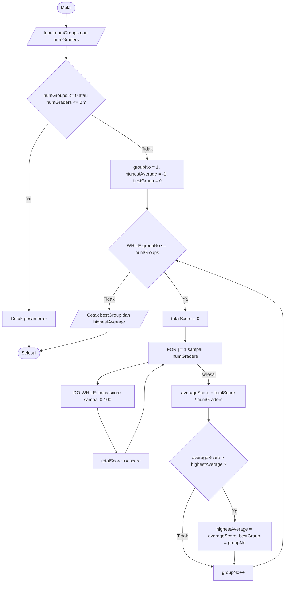
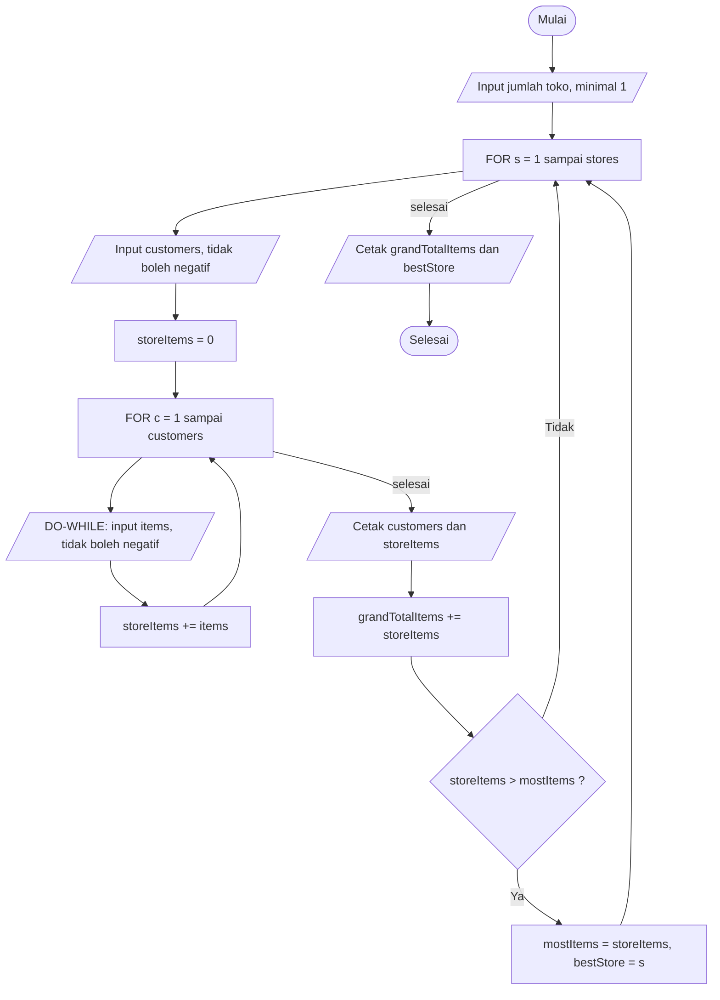

<div align="center">

# 📙 JOBSHEET 8 — PERULANGAN 2 📙

**Praktikum Dasar Pemrograman 2026 · Politeknik Negeri Malang**

</div>

| | |
|---|---|
| 👤 **Nama** | [Elia Beril](https://www.instagram.com/ellxzrst.22/) |
| 🆔 **NIM** | 264107020027 |
| 🔢 **No. Presensi** | 13 |
| 📚 **Mata Kuliah** | Praktikum Dasar Pemrograman |
| 📝 **Materi** | Perulangan 2 (*nested loop*) |
| ☕ **Bahasa** | Java |

> 📝 Dokumen ini memuat **Pertanyaan** (Percobaan 1–4) dan **Tugas**. Langkah-langkah praktikum tidak diulang. Semua hasil *run* berasal dari program yang benar-benar dijalankan.

---

## 🗂️ Struktur Repositori

```text
daspro-jobsheet8
├── experiment/                       → 6 file Percobaan
│   ├── Star13exp.java
│   ├── StarOdd13exp.java
│   ├── Rectangle13exp.java
│   ├── RectangleHash13exp.java
│   ├── Triangle13exp.java
│   └── GroupScore13exp.java
├── assignment/                       → 3 file Tugas
│   ├── Task113assign.java
│   ├── Task213assign.java
│   └── Task313assign.java
└── EliaBeril_Jobsheet_8_Perulangan_2.md (dokumen ini)
```

Klik nama file untuk membuka **kode asli** di repositori

| No | Folder | File (klik untuk lihat kode asli) |
|:-:|---|---|
| 1 | `experiment/` | [`Star13exp.java`](experiment/Star13exp.java) |
| 2 | `experiment/` | [`StarOdd13exp.java`](experiment/StarOdd13exp.java) |
| 3 | `experiment/` | [`Rectangle13exp.java`](experiment/Rectangle13exp.java) |
| 4 | `experiment/` | [`RectangleHash13exp.java`](experiment/RectangleHash13exp.java) |
| 5 | `experiment/` | [`Triangle13exp.java`](experiment/Triangle13exp.java) |
| 6 | `experiment/` | [`GroupScore13exp.java`](experiment/GroupScore13exp.java) |
| 7 | `assignment/` | [`Task113assign.java`](assignment/Task113assign.java) |
| 8 | `assignment/` | [`Task213assign.java`](assignment/Task213assign.java) |
| 9 | `assignment/` | [`Task313assign.java`](assignment/Task313assign.java) |

---

## 📑 Daftar Isi

1. [Percobaan 1 — Review Perulangan 1 (FOR)](#1-percobaan-1--review-perulangan-1-for)
2. [Percobaan 2 — Pola Persegi Panjang (Nested FOR)](#2-percobaan-2--pola-persegi-panjang-nested-for)
3. [Percobaan 3 — Debugging Segitiga Bintang (Nested WHILE)](#3-percobaan-3--debugging-segitiga-bintang-nested-while)
4. [Percobaan 4 — Studi Kasus Nilai Proyek Kelompok](#4-percobaan-4--studi-kasus-nilai-proyek-kelompok)
5. [Tugas](#5-tugas)
6. [Lampiran — Kode Lengkap](#6-lampiran--kode-lengkap-semua-file)
7. [Catatan Asumsi](#7-catatan-asumsi)

---

# 1. Percobaan 1 — Review Perulangan 1 (FOR)

📄 File: [`Star13exp.java`](experiment/Star13exp.java) · Modifikasi Pertanyaan 3: [`StarOdd13exp.java`](experiment/StarOdd13exp.java)

**Hasil run sesuai contoh jobsheet** (n = 5), lalu n = 3 dan n = 7 (langkah 10):

| n | Keluaran | Jumlah `*` |
|:-:|---|:-:|
| 3 | `***` | 3 |
| 5 | `*****` | 5 |
| 7 | `*******` | 7 |

```text
Enter the value of n = 5
*****
```

Jumlah `*` yang tercetak selalu sama dengan `n`, karena perulangan berjalan tepat `n` kali.

### ❓ Pertanyaan 1
**Jika inisialisasi `i = 1` diubah menjadi `i = 0` tanpa mengubah kondisi, berapa `*` yang tercetak saat n = 5? Jelaskan.**

```text
Enter the value of n = 5
******
```

Tercetak **6 bintang**. Dengan `for (int i = 0; i <= n; i++)`, nilai `i` yang lolos kondisi adalah 0, 1, 2, 3, 4, 5, yaitu **6 nilai**, sehingga badan perulangan berjalan 6 kali. Jumlah putaran dihitung dari `batas akhir − nilai awal + 1`, jadi menggeser nilai awal ke 0 menambah satu putaran.

### ❓ Pertanyaan 2
**Jika kondisi `i <= n` diubah menjadi `i < n`, berapa kali perulangan berjalan saat n = 5? Mengapa berbeda?**

```text
Enter the value of n = 5
****
```

Perulangan berjalan **4 kali** (`i` = 1, 2, 3, 4). Pada `i = 5` kondisi `5 < 5` bernilai `false`, jadi perulangan berhenti **sebelum** `i` mencapai `n`. Operator `<=` ikut memproses nilai batas, sedangkan `<` tidak. Beda satu putaran ini adalah sumber kesalahan *off-by-one* yang paling sering muncul.

| Bentuk perulangan | Nilai `i` yang diproses (n = 5) | Jumlah putaran |
|---|---|:-:|
| `i = 1; i <= n` (asli) | 1, 2, 3, 4, 5 | 5 |
| `i = 0; i <= n` | 0, 1, 2, 3, 4, 5 | 6 |
| `i = 1; i < n` | 1, 2, 3, 4 | 4 |

### ❓ Pertanyaan 3
**Prediksikan keluaran kode berikut saat n = 9, lalu verifikasi. Modifikasi agar mencetak bilangan ganjil positif yang tidak melebihi n.**

```java
for (int i = 2; i <= n; i += 2) {
    System.out.print(i + " ");
}
```

**Prediksi:** `i` dimulai dari 2 dan naik 2 setiap putaran, jadi nilainya 2, 4, 6, 8. Berikutnya `i = 10` yang melebihi 9, sehingga berhenti. Keluarannya **`2 4 6 8`**.

**Verifikasi (hasil run):**
```text
Enter the value of n = 9
2 4 6 8 
```

Prediksi cocok. Kode ini mencetak bilangan **genap**.

**Modifikasi untuk bilangan ganjil:** cukup ubah nilai awal `i` menjadi 1 (loncatan 2 tetap).

📄 File: [`StarOdd13exp.java`](experiment/StarOdd13exp.java)

```java
for (int i = 1; i <= n; i += 2) {
    System.out.print(i + " ");
}
```

```text
Enter the value of n = 9
1 3 5 7 9 
```

Untuk `n` genap, bilangan ganjil terbesar selalu tidak melebihi `n`:
```text
Enter the value of n = 10
1 3 5 7 9 
```

### ❓ Pertanyaan 4
**Jelaskan mengapa mengubah `i++` menjadi `i--` (kondisi tetap `i <= n`) membuat perulangan berjalan tanpa henti.**

*(Versi ini tidak dijalankan, sesuai petunjuk jobsheet.)*

`i` dimulai dari 1 lalu **turun**: 1, 0, −1, −2, ... Syarat berhenti adalah `i <= n` menjadi `false`, padahal setiap nilai `i` yang makin kecil justru **selalu lebih kecil dari `n`** (n positif). Kondisinya terus `true` dan arah update menjauhi batas, sehingga perulangan tidak pernah mendekati titik berhenti.

> 💡 Secara teknis `int` di Java punya batas bawah −2.147.483.648. Setelah melewatinya, nilai *melingkar* (*overflow*) ke +2.147.483.647 yang lebih besar dari `n`, dan barulah perulangan berhenti. Untuk n = 5 itu sekitar **2,1 miliar putaran** dan bintang yang tercetak sama banyaknya. Praktis tidak berhenti dalam waktu wajar, sehingga harus dihentikan dengan **Ctrl + C**.

**Aturan umum:** arah update (`++` atau `--`) harus **mendekatkan** variabel ke kondisi berhenti. Perulangan naik berpasangan dengan `<` atau `<=`, perulangan turun berpasangan dengan `>` atau `>=`.

---

# 2. Percobaan 2 — Pola Persegi Panjang (Nested FOR)

📄 File: [`Rectangle13exp.java`](experiment/Rectangle13exp.java) · Modifikasi Pertanyaan 5: [`RectangleHash13exp.java`](experiment/RectangleHash13exp.java)

**Hasil run sesuai contoh jobsheet** (baris 3, kolom 6):
```text
Enter the number of rows: 3
Enter the number of columns: 6
******
******
******
```

**Perbandingan bentuk (langkah 9):**

| (rows, columns) | Keluaran | Bentuk |
|:-:|---|---|
| (3, 6) | `******` ×3 baris | melebar (3 baris, 6 kolom) |
| (4, 2) | `**` ×4 baris | memanjang ke bawah (4 baris, 2 kolom) |
| (1, 5) | `*****` ×1 baris | satu garis horizontal |

```text
Enter the number of rows: 4
Enter the number of columns: 2
**
**
**
**
```
```text
Enter the number of rows: 1
Enter the number of columns: 5
*****
```

### ❓ Pertanyaan 1
**Jelaskan fungsi variabel `i` dan `j` pada program.**

| Variabel | Perulangan | Fungsi |
|:-:|---|---|
| `i` | **luar** (*outer*) | pencacah **baris**. Setiap nilai `i` mewakili satu baris bintang, berjalan dari 1 sampai `rows` |
| `j` | **dalam** (*inner*) | pencacah **kolom**. Setiap nilai `j` mewakili satu bintang dalam baris itu, berjalan dari 1 sampai `columns` |

Nilai `i` tidak dipakai di badan perulangan, jadi hanya berfungsi **menghitung banyaknya baris**. Variabel `j` dibuat ulang dengan nilai 1 pada setiap baris karena dideklarasikan di inisialisasi perulangan dalam.

### ❓ Pertanyaan 2
**Berapa kali perulangan luar, perulangan dalam, dan `print("*")` dieksekusi untuk rows = 4 dan columns = 7?**

| Bagian | Perhitungan | Jumlah |
|---|---|:-:|
| Badan perulangan luar | `rows` | **4** kali |
| Perulangan dalam dimulai | sekali per baris | 4 kali |
| Badan perulangan dalam (total) | 4 baris × 7 kolom | **28** kali |
| `print("*")` | sama dengan badan perulangan dalam | **28** kali |
| `println()` | sekali per baris | 4 kali |

Perulangan dalam **dijalankan ulang dari awal** untuk setiap putaran perulangan luar. Itulah sebabnya total putaran dalam adalah **hasil kali** (4 × 7), bukan hasil tambah.

```text
Enter the number of rows: 4
Enter the number of columns: 7
*******
*******
*******
*******
```
Terlihat 4 baris yang masing-masing berisi 7 bintang, jadi 28 bintang.

### ❓ Pertanyaan 3
**Apa yang terjadi jika batas perulangan luar dan dalam ditukar (luar memakai `columns`, dalam memakai `rows`)? Gunakan rows = 3 dan columns = 6.**

```java
for (int i = 1; i <= columns; i++) {      // luar: sekarang 6 putaran
    for (int j = 1; j <= rows; j++) {     // dalam: sekarang 3 bintang per baris
        System.out.print("*");
    }
    System.out.println();
}
```

Hasil run:
```text
Enter the number of rows: 3
Enter the number of columns: 6
***
***
***
***
***
***
```

Bentuknya menjadi **6 baris × 3 kolom**, yaitu terputar dari yang diminta (3 baris × 6 kolom). Perulangan **luar menentukan jumlah baris** dan perulangan **dalam menentukan jumlah kolom**. Jumlah total bintang tetap 18 (3 × 6) karena perkalian bersifat komutatif, tetapi bentuknya berbeda.

### ❓ Pertanyaan 4
**Jelaskan efek menghapus `System.out.println();` setelah perulangan dalam.**

Tanpa `println()`, kursor tidak pernah pindah ke baris baru, sehingga semua bintang **menyambung dalam satu baris**. Hasil run (rows = 3, columns = 6):

```text
Enter the number of rows: 3
Enter the number of columns: 6
******************
```

Terdapat 18 bintang (3 × 6) dalam satu baris. Jumlah bintangnya benar, hanya bentuk persegi panjangnya hilang. `println()` di akhir tiap putaran luar berfungsi sebagai **pemisah baris**.

### ❓ Pertanyaan 5
**Modifikasi program agar karakter yang dicetak adalah `#`.**

Cukup ganti string pada `print`.

📄 File: [`RectangleHash13exp.java`](experiment/RectangleHash13exp.java)

```java
System.out.print("#");
```

```text
Enter the number of rows: 3
Enter the number of columns: 6
######
######
######
```

---

# 3. Percobaan 3 — Debugging Segitiga Bintang (Nested WHILE)

📄 File (versi akhir): [`Triangle13exp.java`](experiment/Triangle13exp.java)

**Kode awal (starter) yang bermasalah:**

```java
int i = 0;
while (i <= n) {
    int j = 0;
    while (j < i) {
        System.out.print("*");
        j++;
    }
    i++;
}
```

**Langkah 3: keluaran sebenarnya vs target**

| n | Keluaran sebenarnya | Target |
|:-:|---|---|
| 3 | `******` (6 bintang, 1 baris) | `*` / `**` / `***` |
| 5 | `***************` (15 bintang, 1 baris) | `*` / `**` / `***` / `****` / `*****` |

```text
Enter the value of n = 3
******
```
```text
Enter the value of n = 5
***************
```

Jumlah bintangnya sudah "benar" secara total (1+2+3 = 6 dan 1+2+3+4+5 = 15), tetapi **tidak dipisah menjadi baris**.

**Langkah 4–5: baris *debug* sementara** `System.out.print("[i=" + i + "] ");` setelah `while (i <= n) {`:

```text
Enter the value of n = 5
[i=0] [i=1] *[i=2] **[i=3] ***[i=4] ****[i=5] *****
```

### ❓ Jawaban Langkah 5
**a. Berapa kali perulangan luar berjalan? Sama dengan jumlah baris yang diinginkan?**

**6 kali** (`i` = 0, 1, 2, 3, 4, 5). Jumlah baris yang diinginkan adalah **5**, jadi **tidak sama**. Kelebihan satu putaran berasal dari `i` yang dimulai dari 0.

**b. Berapa `*` tercetak saat `i = 0`?**

**0 bintang.** Perulangan dalam `while (j < i)` menjadi `0 < 0` yaitu `false` sejak awal, sehingga badannya tidak pernah berjalan. Pada keluaran debug, `[i=0]` langsung diikuti `[i=1]`.

**c. Mengapa semua karakter tampil dalam satu baris?**

Karena tidak ada `System.out.println()` di mana pun. Hanya `print` yang dipakai, sehingga kursor tidak pernah turun ke baris baru.

### 🔧 Langkah 6: Perbaikan Bertahap

**6a. Tambah `System.out.println();` setelah perulangan dalam, sebelum `i++`:**

```java
while (i <= n) {
    int j = 0;
    while (j < i) {
        System.out.print("*");
        j++;
    }
    System.out.println();   // perbaikan a
    i++;
}
```
```text
Enter the value of n = 5

*
**
***
****
*****
```

Segitiganya sudah terbentuk bertingkat, tetapi **masih ada satu baris kosong di paling atas** (baris untuk `i = 0` yang tidak berisi `*`). Jawaban pertanyaan "apakah masih ada baris tanpa `*`?" adalah **ya**.

**6b. Ubah inisialisasi perulangan luar menjadi `int i = 1;`** (kondisi `i <= n` dipertahankan):

```text
Enter the value of n = 5
*
**
***
****
*****
```

Perulangan luar kini berjalan untuk `i` = 1 sampai 5, tepat **5 kali** tanpa baris kosong, dan keluarannya sama dengan target.

### 🔼🔽 Langkah 7–9: Hapus Debug dan Tambah Segitiga Terbalik

Baris *debug* dihapus, lalu ditambahkan *nested WHILE* kedua di bawah yang pertama. Variabel `i` sudah dideklarasikan, jadi pada WHILE kedua cukup `i = n;` tanpa `int`:

```java
i = n;
while (i >= 1) {
    int j = 0;
    while (j < i) {
        System.out.print("*");
        j++;
    }
    System.out.println();
    i--;
}
```

**Hasil run akhir** (n = 5):
```text
Enter the value of n = 5
*
**
***
****
*****
*****
****
***
**
*
```

Lima baris pertama adalah segitiga biasa, lima baris terakhir cocok dengan tampilan segitiga terbalik di jobsheet. Untuk n = 1 hasilnya dua baris `*`:
```text
Enter the value of n = 1
*
*
```

### ❓ Pertanyaan 1
**Identifikasi ketidaksesuaian keluaran awal dan minimal dua perbaikan agar terbentuk pola segitiga.**

**Ketidaksesuaian:**
1. Semua bintang menyambung dalam **satu baris** (tidak ada pemisah baris).
2. Perulangan luar berjalan **6 kali** (bukan 5), dan putaran pertama (`i = 0`) tidak menghasilkan bintang. Jika dipisah baris, akan ada **baris kosong** di awal.

**Perbaikan:**
1. Tambahkan `System.out.println();` **setelah perulangan dalam** dan **sebelum** `i++`, supaya tiap baris bintang berpindah baris.
2. Ubah inisialisasi menjadi `int i = 1;` (atau pertahankan `i = 0` dengan mengubah kondisi menjadi `i < n` dan mencetak `j <= i`), supaya perulangan luar tepat berjalan `n` kali.

### ❓ Pertanyaan 2
**Jelaskan peran variabel `i` dan `j`. Mengapa `j` harus di-reset ke 0 pada setiap putaran perulangan luar? Apa yang terjadi bila tidak?**

| Variabel | Peran |
|:-:|---|
| `i` | nomor **baris** saat ini sekaligus **banyaknya bintang** yang harus dicetak pada baris itu |
| `j` | penghitung **bintang yang sudah dicetak** pada baris yang sedang dikerjakan |

`j` harus kembali ke 0 di setiap baris karena setiap baris perlu **mulai menghitung dari nol lagi**. Di akhir satu baris, `j` bernilai sama dengan `i`, dan nilai itu tidak boleh terbawa ke baris berikutnya.

**Jika `j` tidak di-reset** (dideklarasikan di luar perulangan luar), hasil run dengan n = 5:
```text
Enter the value of n = 5
*
*
*
*
*
```

Setiap baris hanya berisi **satu bintang**. Pada baris ke-2, `j` sudah bernilai 1 (sisa baris sebelumnya), sehingga `j < 2` hanya benar satu kali sebelum `j` menyusul `i`. Hal yang sama terjadi pada semua baris berikutnya, jadi bentuk segitiga tidak terbentuk. Pada kode yang saya kumpulkan, `int j = 0;` ditulis **di dalam** badan perulangan luar sehingga otomatis dibuat ulang tiap baris.

### ❓ Pertanyaan 3
**Jelaskan perubahan inisialisasi, kondisi, dan update perulangan luar untuk membentuk segitiga terbalik.**

| Komponen | Segitiga biasa | Segitiga terbalik |
|---|:-:|:-:|
| Inisialisasi | `i = 1` | `i = n` |
| Kondisi | `i <= n` | `i >= 1` |
| Update | `i++` | `i--` |

Segitiga biasa **naik** dari 1 sampai `n`, sedangkan segitiga terbalik **turun** dari `n` sampai 1. Karena arahnya berbalik, ketiga komponen berubah bersamaan: titik mulai pindah ke `n`, kondisi memakai `>=` agar nilai 1 masih diproses, dan update memakai `i--` supaya menuju kondisi berhenti. Perulangan dalam tidak berubah (`j` tetap direset ke 0 dan berjalan selama `j < i`), karena banyak bintang per baris tetap sama dengan nilai `i`.

---

# 4. Percobaan 4 — Studi Kasus Nilai Proyek Kelompok

📄 File: [`GroupScore13exp.java`](experiment/GroupScore13exp.java)

Program menerima jumlah kelompok dan jumlah penilai, lalu menghitung rata-rata nilai tiap kelompok dan menentukan kelompok dengan rata-rata tertinggi, tanpa menyimpan semua nilai. Struktur tiga tingkat perulangannya:



**Bagian IF yang dilengkapi (langkah 7):**
```java
if (averageScore > highestAverage) {
    highestAverage = averageScore;
    bestGroup = groupNo;
}
```

**Hasil run sesuai contoh jobsheet** (3 kelompok, 2 penilai, ada input 105):
```text
Enter the number of groups : 3
Enter the number of graders: 2
Group 1
  Score from Grader 1: 80
  Score from Grader 2: 90
Group 1: average score = 85.0
Group 2
  Score from Grader 1: 75
  Score from Grader 2: 105
  Score must be 0-100. Retry!
  Score from Grader 2: 85
Group 2: average score = 80.0
Group 3
  Score from Grader 1: 90
  Score from Grader 2: 96
Group 3: average score = 93.0
==============================
Best group         : 3
Highest average    : 93.0
```

**Variasi (langkah 10):** 2 kelompok dan 3 penilai
```text
Enter the number of groups : 2
Enter the number of graders: 3
Group 1
  Score from Grader 1: 70
  Score from Grader 2: 80
  Score from Grader 3: 90
Group 1: average score = 80.0
Group 2
  Score from Grader 1: 85
  Score from Grader 2: 85
  Score from Grader 3: 85
Group 2: average score = 85.0
==============================
Best group         : 2
Highest average    : 85.0
```

**Input tidak valid** (jumlah kelompok = 0, dan jumlah penilai = 0):
```text
Enter the number of groups : 0
Enter the number of graders: 2
Groups and graders must be > 0.
```
```text
Enter the number of groups : 2
Enter the number of graders: 0
Groups and graders must be > 0.
```

**Rata-rata seri:** kelompok yang ditemukan lebih dulu tetap menjadi pilihan karena memakai `>`, bukan `>=`:
```text
Enter the number of groups : 2
Enter the number of graders: 2
Group 1
  Score from Grader 1: 80
  Score from Grader 2: 90
Group 1: average score = 85.0
Group 2
  Score from Grader 1: 85
  Score from Grader 2: 85
Group 2: average score = 85.0
==============================
Best group         : 1
Highest average    : 85.0
```

### ❓ Pertanyaan 1
**Mengapa `totalScore` harus di-reset di dalam perulangan luar, tetapi `highestAverage` tidak boleh di-reset untuk setiap kelompok?**

- **`totalScore`** adalah jumlah nilai **satu kelompok**. Jika tidak di-reset, nilai kelompok sebelumnya ikut menumpuk dan rata-rata kelompok berikutnya menjadi salah (terlalu besar). Karena itu ia dideklarasikan `double totalScore = 0;` **di dalam** badan WHILE, supaya dibuat ulang untuk setiap kelompok.
- **`highestAverage`** adalah **rekor sementara** dari seluruh kelompok yang sudah diproses. Fungsinya membandingkan kelompok saat ini dengan yang terbaik sejauh ini. Jika di-reset di tiap kelompok, rekor sebelumnya hilang dan kelompok terakhir selalu tampil sebagai yang terbaik. Karena itu ia dideklarasikan **sebelum** WHILE, bersama `bestGroup`.

### ❓ Pertanyaan 2
**Untuk 3 kelompok dan 2 penilai (tanpa input tidak valid), berapa kali badan perulangan FOR dieksekusi secara total?**

Badan FOR berjalan `numGraders` kali untuk setiap kelompok: 3 kelompok × 2 penilai = **6 kali**. Pada hasil run terlihat 6 baris "Score from Grader ...".

### ❓ Pertanyaan 3
**Apa yang terjadi jika `totalScore` dideklarasikan `int` dan rata-rata dihitung dengan pembagian bilangan bulat? Beri contoh nilai.**

Jika `totalScore` bertipe `int`, ekspresi `totalScore / numGraders` adalah **`int` dibagi `int`**, sehingga hasilnya **dipotong menjadi bilangan bulat** *sebelum* disimpan ke `averageScore` yang bertipe `double`. Bagian desimal hilang.

**Contoh:** 1 kelompok, 2 penilai, nilai 85 dan 86 (jumlah 171).

| Versi | Perhitungan | Hasil run |
|---|---|:-:|
| `double totalScore` (asli) | 171.0 / 2 | **85.5** |
| `int totalScore` | 171 / 2 (pembagian bulat) | **85.0** |

```text
Group 1: average score = 85.0     ← versi int (salah, seharusnya 85.5)
Group 1: average score = 85.5     ← versi double (benar)
```

Kesalahan ini juga bisa mengubah **kelompok terbaik**. Misalnya dua kelompok dengan rata-rata asli 85.5 dan 85.0 akan tampil seri (85.0 dan 85.0), sehingga kelompok yang unggul tidak terdeteksi. Perbaikan lain: tetap `int` tetapi memakai *cast*, yaitu `(double) totalScore / numGraders`.

### ❓ Pertanyaan 4
**Mengapa `highestAverage` diberi nilai awal −1, bukan 0? Beri contoh masukan yang menghasilkan hasil salah jika nilai awalnya 0.**

Rata-rata yang mungkin adalah **0 sampai 100**, jadi 0 adalah nilai yang sah. Nilai awal harus **lebih kecil dari semua rata-rata yang mungkin** supaya kelompok pertama **selalu tercatat**. Nilai −1 menjamin hal itu. Dengan nilai awal 0, rata-rata 0 tidak akan pernah lolos `averageScore > highestAverage` (0 > 0 adalah `false`).

**Contoh masukan yang salah bila nilai awal 0:** 2 kelompok, 2 penilai, semua nilai 0.

Hasil run dengan nilai awal **0** (salah):
```text
Group 1: average score = 0.0
Group 2: average score = 0.0
==============================
Best group         : 0
Highest average    : 0.0
```

"Best group: 0" tidak ada artinya karena tidak ada kelompok bernomor 0. Hasil run dengan nilai awal **−1** (benar):
```text
Group 1: average score = 0.0
Group 2: average score = 0.0
==============================
Best group         : 1
Highest average    : 0.0
```

Kelompok 1 tercatat sebagai yang terbaik (seri dengan kelompok 2, dan yang lebih dulu dipertahankan).

### ❓ Pertanyaan 5
**Program memiliki tiga tingkat perulangan. Sebutkan jenis dan peran masing-masing.**

| Tingkat | Jenis | Pencacah | Peran |
|:-:|:-:|:-:|---|
| Luar | **WHILE** | `groupNo` | memproses kelompok satu per satu (1 sampai `numGroups`), mereset `totalScore`, menghitung rata-rata, dan memperbarui kelompok terbaik. `groupNo++` wajib di akhir badan |
| Tengah | **FOR** | `j` | menjalankan proses untuk setiap penilai (1 sampai `numGraders`) dan menjumlahkan nilai ke `totalScore`. Jumlah putarannya sudah pasti, cocok memakai FOR |
| Dalam | **DO-WHILE** | `score` | membaca nilai dan **mengulang input** selama nilai di luar 0–100. Badannya minimal berjalan sekali (nilai harus dibaca dulu sebelum diperiksa), cocok memakai DO-WHILE |

---

# 5. Tugas

### 📌 Tugas 1 — Pola Angka Bertingkat (Nested Number Pattern)

📄 File: [`Task113assign.java`](assignment/Task113assign.java)

Baris ke-`i` mencetak angka 1 sampai `i`. Perulangan **luar** (`i`) mengatur baris dan perulangan **dalam** (`j`) mencetak angka 1 sampai `i`. Variabel `total` bertambah 1 setiap angka dicetak. Input `n` divalidasi (minimal 1) dengan DO-WHILE.

```text
Enter the value of n = 5
1
1 2
1 2 3
1 2 3 4
1 2 3 4 5
Total numbers printed: 15
```

**Hasil uji:**

| n | Total tercetak | Rumus n(n+1)/2 | Keterangan |
|:-:|:-:|:-:|---|
| 1 | 1 | 1 | batas minimum |
| 3 | 6 | 6 | |
| 5 | 15 | 15 | sesuai contoh jobsheet |
| 12 | 78 | 78 | angka dua digit tetap dihitung satu angka |

```text
Enter the value of n = 0
n must be at least 1. Retry!
Enter the value of n = 3
1
1 2
1 2 3
Total numbers printed: 6
```

Pemisah spasi hanya dicetak **di antara** angka (`if (j > 1)`), sehingga tidak ada spasi sisa di ujung baris.

---

### 📌 Tugas 2 — Tabel Perkalian

📄 File: [`Task213assign.java`](assignment/Task213assign.java)

Perulangan luar (`i`) menjadi nomor baris dan perulangan dalam (`j`) menjadi nomor kolom. Setiap posisi menampilkan `i * j` dengan `printf` rata kanan, lalu hasilnya dijumlahkan ke `sum`. Input `n` divalidasi (minimal 3). Lebar kolom dibuat **menyesuaikan angka terbesar** (`n × n`), dengan minimum 4 karakter seperti petunjuk `%4d`, supaya tabel tetap rapi untuk `n` besar.

```text
Enter the value of n = 4
   1   2   3   4
   2   4   6   8
   3   6   9  12
   4   8  12  16
Total of all numbers: 100
```

**Hasil uji:**

| n | Jumlah seluruh angka | Rumus (n(n+1)/2)² |
|:-:|:-:|:-:|
| 3 | 36 | 6² = 36 |
| 4 | 100 | 10² = 100 |
| 5 | 225 | 15² = 225 |
| 12 | 6084 | 78² = 6084 |

```text
Enter the value of n = 2
n must be at least 3. Retry!
Enter the value of n = 5
   1   2   3   4   5
   2   4   6   8  10
   3   6   9  12  15
   4   8  12  16  20
   5  10  15  20  25
Total of all numbers: 225
```

Untuk n = 12 (angka sampai 144, tiga digit) kolom otomatis melebar menjadi 5 karakter sehingga tetap lurus:
```text
Enter the value of n = 12
    1    2    3    4    5    6    7    8    9   10   11   12
    2    4    6    8   10   12   14   16   18   20   22   24
    3    6    9   12   15   18   21   24   27   30   33   36
    4    8   12   16   20   24   28   32   36   40   44   48
    5   10   15   20   25   30   35   40   45   50   55   60
    6   12   18   24   30   36   42   48   54   60   66   72
    7   14   21   28   35   42   49   56   63   70   77   84
    8   16   24   32   40   48   56   64   72   80   88   96
    9   18   27   36   45   54   63   72   81   90   99  108
   10   20   30   40   50   60   70   80   90  100  110  120
   11   22   33   44   55   66   77   88   99  110  121  132
   12   24   36   48   60   72   84   96  108  120  132  144
Total of all numbers: 6084
```

---

### 📌 Tugas 3 — Rekap Penjualan Beberapa Toko

📄 File: [`Task313assign.java`](assignment/Task313assign.java)

Menggunakan **tiga tingkat** perulangan bersarang: FOR untuk toko, FOR untuk pelanggan, dan DO-WHILE untuk memvalidasi input yang tidak boleh negatif. Data tidak disimpan satu per satu, hanya diakumulasi ke variabel total.

| Variabel | Fungsi | Di-reset? |
|---|---|:-:|
| `storeItems` | total barang **satu toko** | ya, tiap toko |
| `grandTotalItems` | total barang **semua toko** | tidak |
| `mostItems` | rekor barang terbanyak sejauh ini (awal −1) | tidak |
| `bestStore` | nomor toko dengan barang terbanyak | tidak |

Nilai awal `mostItems = -1` memastikan toko pertama selalu tercatat meskipun barangnya 0. Pembandingan memakai `>` (bukan `>=`) sehingga bila ada toko yang seri, **toko bernomor terkecil** tetap dipilih.



**Hasil run sesuai contoh jobsheet** (Toko 1: 2 pelanggan membeli 3 dan 2; Toko 2: 3 pelanggan membeli 1, 4, dan 2):
```text
Enter the number of stores: 2
Enter the number of customers at store 1: 2
  Items bought by customer 1: 3
  Items bought by customer 2: 2
Store 1 - customers: 2, total items: 5
Enter the number of customers at store 2: 3
  Items bought by customer 1: 1
  Items bought by customer 2: 4
  Items bought by customer 3: 2
Store 2 - customers: 3, total items: 7
Total items across all stores: 12
Store with the most items: 2
```

**Uji toko seri** (Toko 1 dan Toko 2 sama-sama 5 barang, Toko 3 hanya 4). Toko 1 dipilih:
```text
Enter the number of stores: 3
Enter the number of customers at store 1: 1
  Items bought by customer 1: 5
Store 1 - customers: 1, total items: 5
Enter the number of customers at store 2: 2
  Items bought by customer 1: 2
  Items bought by customer 2: 3
Store 2 - customers: 2, total items: 5
Enter the number of customers at store 3: 4
  Items bought by customer 1: 1
  Items bought by customer 2: 1
  Items bought by customer 3: 1
  Items bought by customer 4: 1
Store 3 - customers: 4, total items: 4
Total items across all stores: 14
Store with the most items: 1
```

**Uji nilai 0 dan validasi input** (jumlah toko 0, jumlah pelanggan −1, dan jumlah barang −3 ditolak, sedangkan 0 diterima):
```text
Enter the number of stores: 0
Number of stores must be at least 1. Retry!
Enter the number of stores: 2
Enter the number of customers at store 1: -1
Must not be negative. Retry!
Enter the number of customers at store 1: 0
Store 1 - customers: 0, total items: 0
Enter the number of customers at store 2: 2
  Items bought by customer 1: -3
  Must not be negative. Retry!
  Items bought by customer 1: 0
  Items bought by customer 2: 0
Store 2 - customers: 2, total items: 0
Total items across all stores: 0
Store with the most items: 1
```

Bila semua toko tidak mencatat penjualan, toko bernomor terkecil (toko 1) yang ditampilkan sesuai aturan seri.

---

# 6. Lampiran — Kode Lengkap Semua File

Salin kode di bawah ke file dengan nama yang tertera, sesuai foldernya.

## 📁 `daspro-jobsheet8/experiment/`

### 📄 [`Star13exp.java`](experiment/Star13exp.java)

```java
// Star13exp.java
import java.util.Scanner;

public class Star13exp {
    public static void main(String[] args) {
        Scanner sc = new Scanner(System.in);
        System.out.print("Enter the value of n = ");
        int n = sc.nextInt();

        for (int i = 1; i <= n; i++) {
            System.out.print("*");
        }
        System.out.println();
        sc.close();
    }
}
```

### 📄 [`StarOdd13exp.java`](experiment/StarOdd13exp.java)

```java
// StarOdd13exp.java (Pertanyaan 3: cetak bilangan ganjil positif <= n)
import java.util.Scanner;

public class StarOdd13exp {
    public static void main(String[] args) {
        Scanner sc = new Scanner(System.in);
        System.out.print("Enter the value of n = ");
        int n = sc.nextInt();

        for (int i = 1; i <= n; i += 2) {
            System.out.print(i + " ");
        }
        System.out.println();
        sc.close();
    }
}
```

### 📄 [`Rectangle13exp.java`](experiment/Rectangle13exp.java)

```java
// Rectangle13exp.java
import java.util.Scanner;

public class Rectangle13exp {
    public static void main(String[] args) {
        Scanner sc = new Scanner(System.in);
        System.out.print("Enter the number of rows: ");
        int rows = sc.nextInt();
        System.out.print("Enter the number of columns: ");
        int columns = sc.nextInt();

        for (int i = 1; i <= rows; i++) {
            for (int j = 1; j <= columns; j++) {
                System.out.print("*");
            }
            System.out.println();
        }
        sc.close();
    }
}
```

### 📄 [`RectangleHash13exp.java`](experiment/RectangleHash13exp.java)

```java
// RectangleHash13exp.java (Pertanyaan 5: karakter diganti #)
import java.util.Scanner;

public class RectangleHash13exp {
    public static void main(String[] args) {
        Scanner sc = new Scanner(System.in);
        System.out.print("Enter the number of rows: ");
        int rows = sc.nextInt();
        System.out.print("Enter the number of columns: ");
        int columns = sc.nextInt();

        for (int i = 1; i <= rows; i++) {
            for (int j = 1; j <= columns; j++) {
                System.out.print("#");
            }
            System.out.println();
        }
        sc.close();
    }
}
```

### 📄 [`Triangle13exp.java`](experiment/Triangle13exp.java)

```java
// Triangle13exp.java (versi akhir setelah debugging + segitiga terbalik)
import java.util.Scanner;

public class Triangle13exp {
    public static void main(String[] args) {
        Scanner sc = new Scanner(System.in);
        System.out.print("Enter the value of n = ");
        int n = sc.nextInt();

        // Segitiga biasa
        int i = 1;
        while (i <= n) {
            int j = 0;
            while (j < i) {
                System.out.print("*");
                j++;
            }
            System.out.println();
            i++;
        }

        // Segitiga terbalik
        i = n;
        while (i >= 1) {
            int j = 0;
            while (j < i) {
                System.out.print("*");
                j++;
            }
            System.out.println();
            i--;
        }
        sc.close();
    }
}
```

### 📄 [`GroupScore13exp.java`](experiment/GroupScore13exp.java)

```java
// GroupScore13exp.java
import java.util.Scanner;

public class GroupScore13exp {
    public static void main(String[] args) {
        Scanner sc = new Scanner(System.in);

        System.out.print("Enter the number of groups : ");
        int numGroups = sc.nextInt();
        System.out.print("Enter the number of graders: ");
        int numGraders = sc.nextInt();

        if (numGroups <= 0 || numGraders <= 0) {
            System.out.println("Groups and graders must be > 0.");
        } else {
            int groupNo = 1;                 // outer loop counter
            double highestAverage = -1;      // -1: the first group is recorded
            int bestGroup = 0;

            while (groupNo <= numGroups) {
                System.out.println("Group " + groupNo);
                double totalScore = 0;

                for (int j = 1; j <= numGraders; j++) {
                    int score;
                    do {
                        System.out.print("  Score from Grader " + j + ": ");
                        score = sc.nextInt();
                        if (score < 0 || score > 100) {
                            System.out.println("  Score must be 0-100. Retry!");
                        }
                    } while (score < 0 || score > 100);
                    totalScore += score;
                }

                double averageScore = totalScore / numGraders;
                System.out.println("Group " + groupNo
                        + ": average score = " + averageScore);

                if (averageScore > highestAverage) {
                    highestAverage = averageScore;
                    bestGroup = groupNo;
                }

                groupNo++;
            }

            System.out.println("==============================");
            System.out.println("Best group         : " + bestGroup);
            System.out.println("Highest average    : " + highestAverage);
        }
        sc.close();
    }
}
```

## 📁 `daspro-jobsheet8/assignment/`

### 📄 [`Task113assign.java`](assignment/Task113assign.java)

```java
// Task113assign.java (Assignment 1: Nested Number Pattern)
import java.util.Scanner;

public class Task113assign {
    public static void main(String[] args) {
        Scanner sc = new Scanner(System.in);
        int n;

        do {
            System.out.print("Enter the value of n = ");
            n = sc.nextInt();
            if (n < 1) {
                System.out.println("n must be at least 1. Retry!");
            }
        } while (n < 1);

        int total = 0;
        for (int i = 1; i <= n; i++) {
            for (int j = 1; j <= i; j++) {
                if (j > 1) {
                    System.out.print(" ");
                }
                System.out.print(j);
                total++;
            }
            System.out.println();
        }

        System.out.println("Total numbers printed: " + total);
        sc.close();
    }
}
```

### 📄 [`Task213assign.java`](assignment/Task213assign.java)

```java
// Task213assign.java (Assignment 2: Multiplication Table)
import java.util.Scanner;

public class Task213assign {
    public static void main(String[] args) {
        Scanner sc = new Scanner(System.in);
        int n;

        do {
            System.out.print("Enter the value of n = ");
            n = sc.nextInt();
            if (n < 3) {
                System.out.println("n must be at least 3. Retry!");
            }
        } while (n < 3);

        // lebar kolom menyesuaikan angka terbesar (n * n), minimal 4 karakter
        int width = Math.max(4, String.valueOf((long) n * n).length() + 2);
        long sum = 0;

        for (int i = 1; i <= n; i++) {
            for (int j = 1; j <= n; j++) {
                int result = i * j;
                System.out.printf("%" + width + "d", result);
                sum += result;
            }
            System.out.println();
        }

        System.out.println("Total of all numbers: " + sum);
        sc.close();
    }
}
```

### 📄 [`Task313assign.java`](assignment/Task313assign.java)

```java
// Task313assign.java (Assignment 3: Sales Recap for Several Stores)
import java.util.Scanner;

public class Task313assign {
    public static void main(String[] args) {
        Scanner sc = new Scanner(System.in);
        int stores;

        do {
            System.out.print("Enter the number of stores: ");
            stores = sc.nextInt();
            if (stores < 1) {
                System.out.println("Number of stores must be at least 1. Retry!");
            }
        } while (stores < 1);

        int grandTotalItems = 0;
        int bestStore = 0;
        int mostItems = -1;          // -1: toko pertama selalu tercatat (walau 0 barang)

        for (int s = 1; s <= stores; s++) {
            int customers;
            do {
                System.out.print("Enter the number of customers at store " + s + ": ");
                customers = sc.nextInt();
                if (customers < 0) {
                    System.out.println("Must not be negative. Retry!");
                }
            } while (customers < 0);

            int storeItems = 0;
            for (int c = 1; c <= customers; c++) {
                int items;
                do {
                    System.out.print("  Items bought by customer " + c + ": ");
                    items = sc.nextInt();
                    if (items < 0) {
                        System.out.println("  Must not be negative. Retry!");
                    }
                } while (items < 0);
                storeItems += items;
            }

            System.out.println("Store " + s + " - customers: " + customers
                    + ", total items: " + storeItems);

            grandTotalItems += storeItems;
            if (storeItems > mostItems) {      // '>' : jika seri, toko bernomor kecil tetap dipilih
                mostItems = storeItems;
                bestStore = s;
            }
        }

        System.out.println("Total items across all stores: " + grandTotalItems);
        System.out.println("Store with the most items: " + bestStore);
        sc.close();
    }
}
```

---

# 7. Catatan Asumsi

- Nama file memakai nomor presensi 13 menggantikan `StudentNo` pada jobsheet, ditambah akhiran folder (`exp` untuk experiment, `assign` untuk assignment), mis. `Star13exp.java` dan `Task113assign.java` (`Task1` + `13` + `assign`). Nama class di dalam file mengikuti nama file persis.
- Nama folder repositori mengikuti langkah jobsheet, yaitu `daspro-jobsheet8`. Folder `experiment/` dan `assignment/` mengikuti pola jobsheet sebelumnya.
- Modifikasi pada Pertanyaan (Percobaan 1 no. 3 dan Percobaan 2 no. 5) saya simpan sebagai **file terpisah** (`StarOdd13exp.java` dan `RectangleHash13exp.java`), sehingga file utama tetap sama dengan langkah jobsheet.
- Kode simulasi pada Pertanyaan (mis. `i = 0`, `i < n`, batas perulangan ditukar, `println()` dihapus, `j` tidak di-reset, `totalScore` bertipe `int`, `highestAverage` bernilai 0) hanya dijalankan **sementara** untuk melihat akibatnya dan tidak ikut dikumpulkan. Versi `i--` pada Percobaan 1 Pertanyaan 4 **tidak dijalankan**, sesuai petunjuk jobsheet. Penjelasannya berdasarkan analisis kode.
- `Triangle13exp.java` adalah **versi akhir** Percobaan 3 (sudah diperbaiki, baris *debug* dihapus, dan sudah memuat segitiga terbalik). Kode starter yang bermasalah hanya ditampilkan di dokumen ini.
- Pada **Percobaan 4**, jobsheet meminta bagian IF dilengkapi sendiri. Isinya `highestAverage = averageScore;` dan `bestGroup = groupNo;`. Teks pada baris hasil "Best group" dan "Highest average" saya sejajarkan titik duanya.
- Pada **Tugas 1**, saya menghitung **banyaknya angka** yang dicetak (sesuai label contoh "Total numbers printed: 15"), bukan banyaknya karakter digit. Keduanya sama untuk n ≤ 9. Untuk n = 12 ada 78 angka (84 karakter digit). Input n kurang dari 1 diminta ulang.
- Pada **Tugas 2**, input n kurang dari 3 diminta ulang. Lebar kolom `printf` dibuat dinamis (minimal 4, sesuai petunjuk `%4d`) agar tetap rapi untuk n besar, dan jumlah total memakai tipe `long`.
- Pada **Tugas 3**, ringkasan per toko dicetak langsung setelah data tiap toko selesai diinput (bukan di akhir), karena data tidak boleh disimpan satu per satu. Input negatif diminta ulang, sedangkan 0 diterima.
- Contoh *run* pada dokumen ini dijalankan di terminal sungguhan dengan Java 21, sehingga masukan pengguna tampil di baris yang sama dengan pertanyaannya.

<div align="center">

— *Elia Beril · 264107020027* —

</div>
